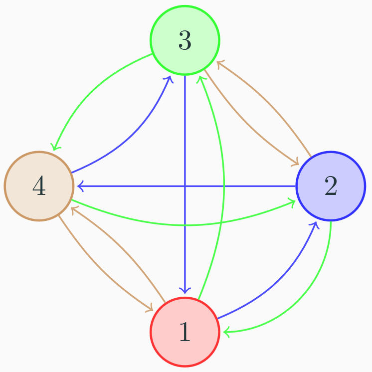
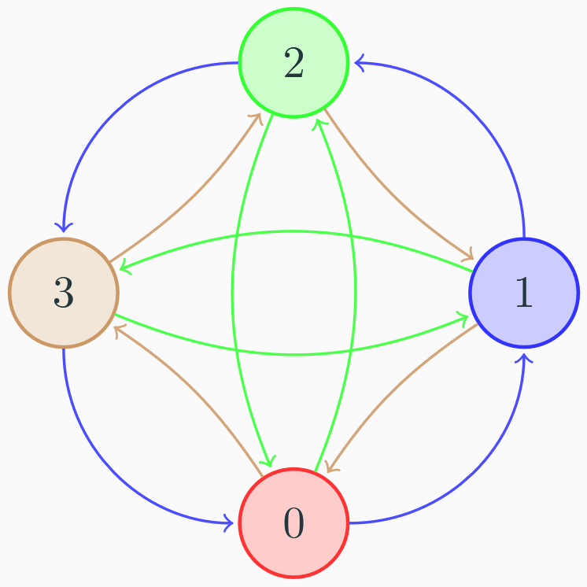

$\newcommand{\zx}[1]{\mathbb{Z}_{#1}^\times}$
$\newcommand{\zp}[1]{\mathbb{Z}_{#1}^+}$

Uvažujme nyní 2, na první pohled různé, grupy a podívejme se na jejich vlastnosti

### Grupa $\zx{5}$

| $\zx{5}$ | 1 | 2 | 3 | 4 |
|----------|---|---|---|---|
| 1        | 1 | 2 | 3 | 4 |
| 2        | 2 | 4 | 1 | 3 |
| 3        | 3 | 1 | 4 | 2 |
| 4        | 4 | 3 | 2 | 1 |

- **Řád**: 4
- **Podgrupy:** $\{1\}, \{1, 4\}, \{1, 2, 3, 4\}$
- **Neutrální prvek:** 1
- **Inverze:** $1^{−1} = 1, 2^{−1} = 3, 3^{−1} = 2, 4^{−1} = 4$

### Grupa $\zp{4}$

| $\zp{4}$ | 0 | 1 | 2 | 3 |
|----------|---|---|---|---|
| 0        | 0 | 1 | 2 | 3 |
| 1        | 1 | 2 | 3 | 0 |
| 2        | 2 | 3 | 0 | 1 |
| 3        | 3 | 0 | 1 | 2 |

- **Řád**: 4
- **Podgrupy:** $\{0\}, \{0, 2\}, \{0,1,2,3\}$
- **Neutrální prvek:** 0
- **Inverze:** $0^{−1} = 0, 1^{−1} = 3, 2^{−1} = 2, 3^{−1} = 1$

Nejsou $\zp{4}$ a $\zx{5}$ vlastně stejné grupy lišící se pouze ve "jménech" 
svých prvků a označení operace?

### Cayleho graf grupy $\zx{5}$:
{ align=center }

### Cayleho graf grupy $\zp{4}$:
{ align=center }

### Přejmenování prvků

Zkusme tedy přejmenovat prvky grupy $\zx{5}$ tak, abychom dostali $\zp{4}$:

- Neutrální prvek má velmi speciální a jedinečné vlastnosti, proto přejmenujme 1 na 0
- Pokud se má zachovat kompletně struktura, musí jediné dvouprvkové podgrupě $\{1, 4\$} (v $\zx{5}$) odpovídat podgrupa $\{0, 2\}$ (v $\zp{4}$), proto $4 \leftrightarrow  2$
- Nyní už stačí přejmenovat 2 a 3: zjistíme, že obě zbývající možnosti fungují, zvolme tedy např. $3 \leftrightarrow 1$ a $2 \leftrightarrow 3$,
- Nakonec už stačí přeházet řádky $\dots$ a máme Cayleyho tabulku $\zp{4}$

- Toto přejmenování je vlastně **prosté** zobrazení množiny $\{1, 2, 3, 4\}$ **na** množinu $\{0, 1, 2, 3\}$, označme jej $h_1$:
- $$h_1(1) = 0, h_1(2) = 3, h_1(3) = 1, h_1(4) = 2$$
- Jak jsme naznačili, fungovalo by i $h_2$
- $$h_2(1) = 0, h_2(2) = 1, h_2(3) = 3, h_2(4) = 2$$

Ne každá bijekce by ale fungovala správně, uvažme například bijekci $h_3$:

$$h_3(1) = 0, h_3(2) = 3, h_3(3) = 2, h_3(4) = 1$$

| $h_3(\zx{5})$ | 0 | 1 | 2 | 3 |
|---------------|---|---|---|---|
| 0             | 0 | 3 | 2 | 1 |
| 1             | 3 | 1 | 0 | 2 |
| 2             | 2 | 0 | 1 | 3 |
| 3             | 1 | 2 | 3 | 0 |

- Výsledná tabulka ale neodpovídá grupě $\zp{4}$, neboť například $3 + 3 \pmod{4}̸ = 1$.
- Bijekce $h_3$ tedy nevytvoří stejnou strukturu jakou má grupa $\zp{4}$, takovou vlastnost mají pouze $h_1$ a $h_2$.

Hledaná vlastnost bijekce $h$, kterou mají pouze bijekce $h_1$ a $h_2$, je tato:

- pro všechna $n, m \in \{1, 2, 3, 4\}$ platí $h(n \times_5 m) = h(n) +_4 h(m)$

Neboli:  Jestliže na libovolné prvky v grupě $\zx{5}$ aplikujeme operaci $\times_5$ a pak je zobrazíme do $\zp{4}$
pomocí $h$, dostaneme vždy stejný výsledek, jako kdybychom je nejdříve pomocí $h$ zobrazili do
$\zp{4}$ a **potom** aplikovali operaci $+_4$.

Bijekce musí **zachovávat operaci**
