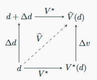

!!! Implication "[Poznámka 4.3 (Značení úloh a řešení)](#note-4.3)"

    ### Poznámka 4.3 (Značení úloh a řešení) {#note-4.3}

    Nechť $V^*$ je zobrazení, které vstupním datům $d$ přiřadí **přesné** řešení $V^*(d)$ nějaké **úlohy**.  

    Nechť $V$ je numerický algoritmus řešící tuto úlohu, $V(d)$ je jeho výsledek v přesné aritmetice. Výsledek
    jeho výpočtu v konečné (strojové) aritmetice označíme $\widehat{V}(d)$  

    Data i výsledky mohou být čísla i vektory, jejich velikost měříme normou $\|\cdot\|$ (pro čísla absolutní
    hodnotou)

Budeme rozlišovat:
- jak citlivá je na změnu dat samotná úloha $V^∗$ (**podmíněnost**),
- jak dobře algoritmus $V$ úlohu řeší (**stabilita**)

!!! Definition "[Definice 4.6 (Dopředná chyba)](#def-4.6)"

    ### Definice 4.6 (Dopředná chyba) {#def-4.6}

    Hodnotu $\Delta v = \widehat{V}(d) - V^*(d)$ nazýváme **dopředná/přímá chyba** (_forward error_). 
    Jedná se o odchylku spočítaného řešení od přesného řešení.

    **Dopředná relativní chyba** je pak zlomek $\frac{\| \Delta v \|}{\| V^*(d) \|}$

!!! Definition "[Definice 4.7 (Zpětná chyba)](#def-4.7)"

    ### Definice 4.7 (Zpětná chyba) {#def-4.7}

    Vektor $\Delta d$ nejmenší normy takový, že $V^∗(d + \Delta d) = \widehat{V}(d)$, je **zpětná chyba** (_backward error_). 
    Jedná se o promítnutí chyby algoritmu $V$ do jeho vstupu – jaký problém byl ve skutečnosti vyřešen. 

    Obdobně můžeme počítat i **relativní zpětnou chybu** jako: $\frac{\| \Delta d \|}{d}$

!!! Definition "[Definice 4.8 (Zpětná stabilita algoritmu)](#def-4.8)"

    ### Definice 4.8 (Zpětná stabilita algoritmu) {#def-4.8}

    Pokud pro všechny vstupy $d$ platí:

    $$\frac{\| \Delta d \|}{d} \le Q \mathbf{u}$$

    pro nějakou ne příliš velkoui konstantu $Q$ a pro [zaokrouhlovací jednotku](4.3_Floaty.md#def-4.5) $\mathbf{u}$,
    řekneme, že algoritmus je **zpětně stabilní** (_backward stable_).

{ align=center, width=50% }

Chyby jsou vizualizovány na obrázku. K exaktnímu řešení se můžeme "dostat" dvěma způsoby:

- Buď spustíme numerický algoritmus na původní data z toho určíme **dopřednou chybu** (dolní cesta)
- Nebo data změníme o **zpětnou chybu** a na upravená data pustíme numerický algoritmus (horní cesta)

!!! example "[Příklad 4.5 (Zpětná chyba a aritmetické operace)](#ex-4.5)"

    Podle tvrzení o aritmetických operacích pro $x,y \in F$

    $$\mathrm{fl}(x \pm y) = (x \pm y)(1 + \delta) = x(1 + \delta) \pm y(1 + \delta) \text{, kde } |\delta| \le \mathbf{u}$$

    Spočítaný výsledek $\widehat{V}(d) = \mathrm{fl}(x \pm y)$ je tedy přesným řešením úlohy 
    $V^*(x, y) = x \pm y$ pro porušená data $d + \Delta d = (x(1 + \delta), y(1 + \delta))$, kde 
    $d = (x, y)$. 

    Protože $\Delta d = \delta \cdot d$, je relativní zpětná chyba nejvýše
    $\frac {\| \Delta d \|}{\| d \|} = \| \delta \| \le \mathbf{u}$ (v libovolné normě). 
    Podobně $\mathrm{fl}(xy) = x(1 + \delta) \cdot y$ a $\mathrm{fl}(x/y) = x(1 + \delta)/y$.  

    Jednotlivé aritmetické operace jsou proto **zpětně stabilní**.

!!! Warning "[Chyba při odečítání](#warning-4.1)"

    Přestože jsme viděli, že odečítání může vést ke ztrátě platných cifer, je stále numericky zpětně stabilní. 
    Malá zpětná chyba tedy ještě nezaručuje malou dopřednou chybu. Chybí nám vlastnost samotné úlohy.

---

!!! Definition "[Definice 4.9 (Podmíněnost a číslo podmíněnosti)](#def-4.9)"

    ### Definice 4.9 (Podmíněnost a číslo podmíněnosti) {#def-4.9}

    **Podmíněnost** úlohy vyjadřuje citlivost výstupu na malou změnu (perturbaci) $\Delta d$ vstupních dat.

    **Relativní číslo podmíněnosti** (*relative condition number*) úlohy $V^*$ v bodě $d$ je
    
    $$
    C_r = \lim_{\eta \to 0^+} \sup_{\substack{d + \Delta d \in D \\ \|\Delta d\| \le \eta}} \frac{\frac{\|V^*(d + \Delta d) - V^*(d)\|}{\|V^*(d)\|}}{\frac{\|\Delta d\|}{\|d\|}},
    $$
    
    kde $D$ je zkoumaný definiční obor $V^*$.

    Pro malé $\Delta d$ tedy přibližně platí

    $$
    \frac{\|V^*(d + \Delta d) - V^*(d)\|}{\|V^*(d)\|} \lesssim C_r \frac{\|\Delta d\|}{\|d\|}.
    $$

!!! Implication "[Poznámka 4.4 (Vysvětlení vzorce)](#note-4.4)"

    ### Poznámka 4.4 (Vysvětlení vzorce) {#note-4.4}

    Čitatel zlomku v definici čísla podmíněnosti označuje relativní změnu teoretického výstupu úlohy.
    Jmenovatel pak relativní změnu vstupu.

    Celkově tedy určuje jak moc se mění výstup při změně vstupu.

    ---

    Supremum zajišťuje nejhorší případ a omezuje změny dat (tak, že stále patří do def. oboru a že nejsou moc velké)

    A v neposlední řadě limita zkoumá vztah u minimální veliksoti změny dat.

!!! Definition "[Definice 4.10 (Dobrá a špatná podmíněnost)](#def-4.10)"

    ### Definice 4.10 (Dobrá a špatná podmíněnost) {#def-4.10}

    Není-li $C_r$ velké, řekneme, že úloha je **dobře podmíněná** (_well-conditioned_). Je-li velké,
    řekneme, že úloha je **špatně podmíněná** (_ill-conditioned_).

!!! Warning "[Podmíněnost](#warning-4.2)"

    Podmíněnost je vlastnost úlohy, nikoliv algoritmu.

!!! example "[Příklad 4.5 (Podmíněnost I)](#ex-4.5)"

    Mějme diferencovatelnou funkci $f: \mathbb{R} \to \mathbb{R}$ a $x$ takové, že $f(x) \neq 0$. Zkuste spočítat
    z definice její číslo podmíněnosti.

    Jakou hodnotu bude mít pro $g(x) = \sqrt{x}$ a pro $h(x) = e^x$?

??? proof "Řešení příkladu 4.5"

    Pro diferencovatelnou funkci $f: \mathbb{R} \to \mathbb{R}$ a $x$ takové, že $f(x) \neq 0$, z definice dostaneme

    $$
    C_r = \lim_{\Delta x \to 0} \left| \frac{f(x + \Delta x) - f(x)}{\Delta x} \right| \cdot \frac{|x|}{|f(x)|} = \frac{|x f'(x)|}{|f(x)|}.
    $$

    ---

    Tedy pro specifické případy platí:    

    - $g(x) = \sqrt{x}$: $C_r = \frac{|x \frac{1}{2\sqrt{x}}|}{|\sqrt{x}|} = \frac{|x|}{2|x|} = \frac{1}{2}$ (dobře podmíněná),
    * $h(x) = e^x$: $C_r = \frac{|x e^x|}{|e^x|} = |x|$ (špatně podmíněná pro velká $|x|$).
    

!!! example "[Příklad 4.6 (Podmíněnost II)](#ex-4.6)"

    Změníme-li vstupy $x, y \neq 0$ relativně nejvýše o $\eta$, tj. na $x(1 + \delta_1)$ a $y(1 + \delta_2)$, 
    kde $|\delta_1|, |\delta_2| \le \eta$. Jaké budou čísla podmíněnosti pro násobení a odečítání?
    
    
  
??? proof "Řešení příkladu 4.6"
  
    Pro násobení dostaneme: $\frac{|x(1 + \delta_1)y(1 + \delta_2) - xy|}{|xy|} \le 2\eta + \eta^2$, tedy $C_r \le 2$,
    
    ---
  
    Pro odečítání ($x \neq y$) pak:

    $$
    \frac{|x(1 + \delta_1) - y(1 + \delta_2) - (x - y)|}{|x - y|} = \frac{|x\delta_1 - y\delta_2|}{|x - y|} \le \frac{|x| + |y|}{|x - y|} \eta.
    $$
    
    Odečítání blízkých čísel je tedy **špatně podmíněná** úloha: $C_r = \frac{|x| + |y|}{|x - y|}$.

!!! Theorem "[Věta 4.7 (O vztahu podmíněnosti a stability)](#theorem-4.7)"

    ### Věta 4.7 (O vztahu podmíněnosti a stability) {#theorem-4.7}

    Nechť je algoritmus $V$ zpětně stabilní, tedy $\widehat{V}(d) = V^*(d + \Delta d)$, kde $\frac{\| \Delta d \|}{\| d \|} \le Q \mathbf{u}$

    Pak (z definice čísla podmíněnosti pro malé $\Delta d$) platí:

    $$
    \underbrace{\frac{\| \widehat{V}(d) - V^*(d) \|}{\| V^*(d) \|}}_{\text{rel. dopředná chyba}} = \frac{\| V^*(d + \Delta d) - V^*(d) \|}{\| V^*(d) \|} \lesssim C_r
    $$

    $$
    \underbrace{\frac{\| \Delta d \|}{\| d \|}}_{\text{rel. zpětná chyba}} \le C_r Q \mathbb{u}
    $$

    Celkově tedy:

    **relativní dopředná chyba** $\lesssim$ **číslo podmíněnosti** $\times$ **relativní zpětná chyba**

!!! Theorem "[Věta 4.8 (O chybách ve výpočtu)](#theorem-4.8)"

    ### Věta 4.8 (O chybách ve výpočtu) {#theorem-4.8}

    Nechť $\widehat{d}$ jsou skutečně dostupná (např. naměřená a uložená) data místo přesných dat $d$. Připomeňme, že
    $V$ je výsledek algoritmu v přesné aritmetice a $\widehat{V}$ ve strojové. Pak lze napsat:

    $$
    \widehat{V}(\widehat{d}) - V^*(d) = 
    \underbrace{\widehat{V}(\widehat{d}) - V(\widehat{d})}_{\text{zaokrouhlovací chyba}} 
    + \underbrace{V(\widehat{d}) - V^*(\widehat{d})}_{\text{chyba algoritmu}} 
    + \underbrace{V^*(\widehat{d}) - V^*(d)}_{\text{vliv chyby dat}}
    $$

- **Chyba modelu**: $V^*$ je sama jen přibližným popisem skutečnosti; tuto chybu žádný výpočet neodstraní.
- **Chyba dat**: její vliv na výsledek určuje podmíněnost úlohy
- **Chyba algoritmu** (metody): vzniká i v přesné aritmetice, např. useknutím řady či ukončením iterací.
- **Zaokrouhlovací chyba**: popisujeme ji zpětnou chybou (stabilita algoritmu)
