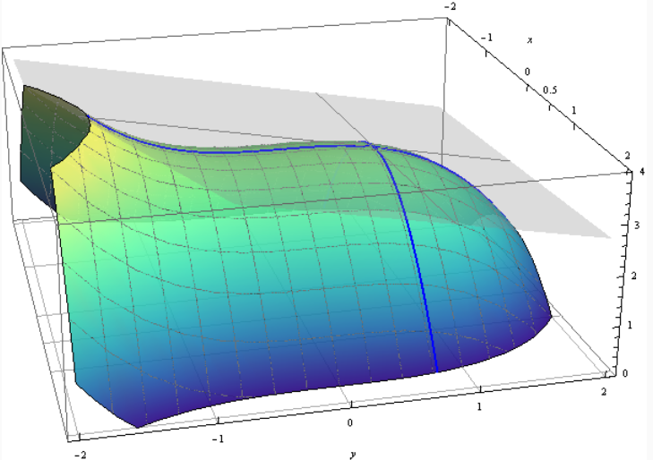

$\newcommand{\m}[1]{\mathbf{#1}}$

!!! Definition "[Definice 6.10 (Parciální derivace)](#def-6.10)"

    ### Definice 6.10 (Parciální derivace) {#def-6.10}

    **Parciální derivace funkce** $f: D_f \subseteq \mathbb{R}^n \to \mathbb{R}$ 
    **ve směru** $x_i$ (nebo podle $x_i$) ve vnitřním bodě $\m{b} = (b_1, b_2, \dots, b_n) \in D_f$, je

    $$
    \begin{align}
        \lim_{h \to 0} & \frac{f(b_1, b_2, \dots, b_i + h, \dots, b_n) - f(b_1, b_2, \dots, b_i, \dots, b_n)}{h} = \\
        \lim_{h \to 0} & \frac{f(\m{b} + \m{e}_i h) - f(\m{b})}{h} = L \in \mathbb{R}
    \end{align}
    $$
    
    pokud tato limita existuje. Značíme ji $\frac{\partial f}{\partial x_i}(\m{b}) = L$. 
    (Jiná častá značení: $\partial_{x_i} f(\m{b})$ a $f_{x_i}(\m{b})$.)

Jedná se o směrnici tečny ke grafu funkce $f$ ve směru osy $x_i$.

!!! Definition "[Definice 6.11 (Gradient)](#def-6.11)"

    ### Definice 6.11 (Gradient) {#def-6.11}

    Gradient funkce $f$ v bodě $\m{b} \in D_f$, kde existují všechny parciální derivace, je (řádkový) vektor

    $$
    \nabla f(\m{b}) = \left(\frac{\partial f}{\partial x_1}(\m{b}), \frac{\partial f}{\partial x_2}(\m{b}), \dots, \frac{\partial f}{\partial x_n}(\m{b})\right).
    $$

Poznámka: jelikož se gradient opírá o pojem parc. derivace, bod $\m{b}$ je nutně vnitřním bodem $D_f$.

Zároveň je tato definice zjednodušená: lze ji použít pokud jsou všechny parciální derivace funkce
$f$ spojité na nějakém okolí bodu $\m{b}$. oto zjednodušení uvažujeme, protože s funkcemi, pro které to neplatí, 
vesměs pracovat nebudeme. Nezjednodušená definice vypadá takto:

??? Proof "Nezjednodušená definice gradientu"

    
    !!! Definition "[Definice 6.12 (Gradient II)](#def-6.12)"

        Gradient funkce $f$ v bodě $\m{b} \in D_f$ je řádkový vektor $\m{v}$, pro který platí:
    
        $$
            \lim_{\m{x} \to \m{b}} \frac{|f(\m{x}) - f(\m{b}) - \m{v} \cdot (\m{x} - \m{b})|}{\| \m{x} - \m{b}\|} = 0
        $$

!!! Definition "[Definice 6.13 (Derivace ve směru)](#def-6.13)"

    ### Definice 6.13 (Derivace ve směru) {#def-6.13}

    Nechť $\m{v} \in \mathbb{R}^{n,1} = \mathbb{R}^n$, $\|\m{v}\|_2 = 1$. **Derivace funkce** $f$ **ve směru** $\m{v}$ ve vnitřním bodě $\m{b} \in D_f$ je

    $$
    \nabla_{\m{v}} f(\m{b}) = \lim_{h \to 0} \frac{f(\m{b} + h\m{v}) - f(\m{b})}{h},
    $$

    pokud tato limita existuje.

!!! Theorem "[Věta 6.7 (O hodnotě derivace ve směru)](#theorem-6.7)"

    ### Věta 6.7 (O hodnotě derivace ve směru) {#theorem-6.7}

    Jsou-li všechny parciální derivace funkce $f$ na nějakém okolí bodu $\m{b}$ spojité, pak platí

    $$
    \nabla_{\m{v}} f(\m{b}) = \nabla f(\m{b}) \cdot \m{v}.
    $$

!!! Definition "[Definice 6.14 (Tečná nadrovina)](#def-6.14)"

    ### Definice 6.14 (Tečná nadrovina) {#def-6.14}

    Má-li funkce $f: D_f \to \mathbb{R}$, kde $D_f \subseteq \mathbb{R}^n$, v bodě $\m{b} \in D_f$ gradient, 
    pak **tečná nadrovina** funkce $f$ v bodě $\m{b}$ je množina bodů $(x_1, x_2, \dots, x_n, z)$ ležících v 
    $\mathbb{R}^{n+1}$, které splňují rovnici
    
    $$
    z = \nabla f(\m{b}) \cdot (\m{x} - \m{b}) + f(\m{b}),
    $$
    
    kde $\m{x} = (x_1, \dots, x_n)$ a $\m{b} = (b_1, \dots, b_n)$.

### Příklad tečné nadroviny

{ align=center, width=75% }

!!! Theorem "[Věta 6.8 (Nutná podmínka existence lokálního extrému)](#theorem-6.8)"

    Nechť má funkce $f : D_f \to \mathbb{R}, D_f \subseteq \mathbb{R}^n$, 
    v bodě $\m{b}$ parciální derivaci podle $i$-té proměnné.

    Pokud $f$ má v bodě $\m{b}$ lokální extrém, potom
    
    $$
    \frac{\partial f}{\partial x_i}(\m{b}) = 0.
    $$

!!! Implication "[Důsledek 6.1 (Gradient a lokální extrém)](#implication-6.1)"

    ### Důsledek 6.1 (Gradient a lokální extrém) {#implication-6.1}

    Pokud existuje gradient funkce $f$ v bodě $\m{b}$, pak existence lokálního extrému v bodě $\m{b}$ implikuje

    $$
    \nabla f(\m{b}) = \theta.
    $$

!!! Definition "[Definice 6.15 (Stacionární bod)](#def-6.15)"

    ### Definice 6.15 (Stacionární bod) {#def-6.15}

    Body $\m{b} \in D_f$ splňující $\nabla f(\m{b}) = \theta$ se nazývají **stacionární**.
