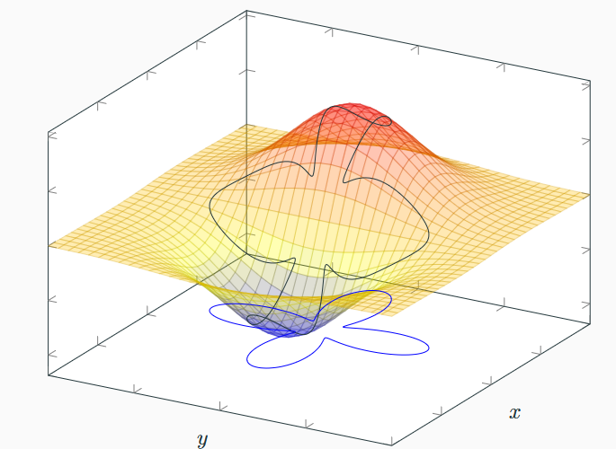
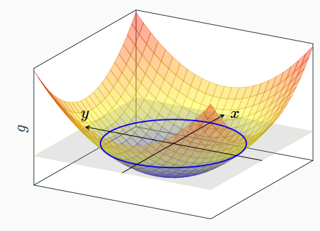
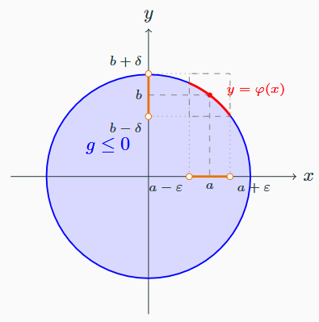

$\newcommand{\m}[1]{\mathbf{#1}} \newcommand{\ints}{\text{int }}$

V minulé kapitole bylo cílem hledat extrémy na celém definičním oboru. Co když nás ale zajímají extrémy
pouze na nějaké podmnožině definičního oboru.

- Omezení je pak základem pro počítání optimalizačních funkcí, častokdy hledáme maximum/minimum nějaké
účelové funkce za podmínek daných modelem
- Na následujícím obrázku můžeme vidět přiklad takové úlohy: _Nalezněte maximum 
a minimum, když se ”pohybujeme“ na grafu pouze po černé křivce (= nad modrou křivkou)_

{ align=center }

Pro demostraci uvedeme větu o implicitní funkci, ta platí v mnohem větší obecnosti než jen ve 2D,
nám ale bude stačit tato verze

!!! Theorem "[Věta 7.1 (O implicitní funkci)](#theorem-7.1)"

    ### Věta 7.1 (O implicitní funkci) {#theorem-7.1}

    Nechť $g: \mathbb{R}^2 \to \mathbb{R}$ a 
    $\frac{\partial g}{\partial x}, \frac{\partial g}{\partial y}$ jsou spojité v okolí bodu $(a,b)$.
    Předpokládejme dále, že

    $$
    g(a,b) = 0 \qquad \text{a} \qquad \frac{\partial g}{\partial y}(a,b) \neq 0.
    $$
    
    1. Pak existují $\varepsilon > 0$, $\delta > 0$ a obdélníkové okolí 
    $R := \{(x,y) : |x - a| < \varepsilon, |y - b| < \delta\}$ bodu $(a,b)$ takové, že pro každé 
    $x \in (a - \varepsilon, a + \varepsilon)$ existuje právě jedno $y \in (b - \delta, b + \delta)$, 
    které splňuje rovnici $g(x,y) = 0$. Tedy $y$ je funkcí proměnné $x$ a lze psát $y = \varphi(x)$. 
    Definiční obor $\varphi$ je interval $(a - \varepsilon, a + \varepsilon)$.
    
    2. Funkce $\varphi$ určená v bodě (a) a její derivace $\varphi'$ jsou spojité 
    na intervalu $(a - \varepsilon, a + \varepsilon)$ a platí
    
    $$
    \varphi'(x) = -\frac{\frac{\partial g}{\partial x}(x, \varphi(x))}{\frac{\partial g}{\partial y}(x, \varphi(x))} \text{ pro } x \in (a - \varepsilon, a + \varepsilon).
    $$

Na první pohled vypadá věta poměrně krypticky, ale pro pochopení si stačí představit 2D funkci jako krajinu. Nacházíme-li
se v bodě, kde je nulová nadmořská výška (a zároveň se nejdená o lokální extrém ani sedlový bod), pak existuje nějaké okolí,
kde pro zeměpisnou šířku najdeme příslušnou zeměpisnou délku, kde je stále nulová nadmořská výška

### Příklad: implicitní funkce pro $g(x,y) = x^2 + y^2 + 1$

Mějme funkci $g(x,y) = x^2 + y^2 + 1$, kterou vidíme na následujícím obrázku. $\frac{\partial g}{\partial x} = 2x, \frac{\partial g}{\partial y} = 2y$.

Rovina, která ji protíná je $z = 0$, její průnik s grafem je tedy množina $g(x,y) = 0$, tedy jednotková kružnice.

{ align=center }

Pokud by např. $(a,b) = (\frac{3}{5}, \frac{4}{5})$, pak $g(a,b) = 0, \frac{\partial g}{\partial y} = \frac{8}{5} \neq 0$

- Pro $\varepsilon = 0,2, \delta = 0,21$ je na $(a - \varepsilon, a + \varepsilon)$ právě jedno $y \in (b - \delta, b+ \delta)$
s $g(x,y) = 0$, a to $y = \varphi(x) = \sqrt{1 - x^2}$. Protože i $g(a,b) = 0, \frac{\partial g}{\partial x} = \frac{6}{5} \neq 0$,
lze vyjádřit $x$ jako funkci $y$

{ align=center }

Pokud by $(a,b) = (-\frac{3}{5}, -\frac{4}{5})$, pak $g(a,b) = 0, \frac{\partial g}{\partial y} = -\frac{8}{5} \neq 0$

- Pro $\varepsilon = 0,2, \delta = 0,21$ je  $y = \varphi(x) = -\sqrt{1 - x^2} \in (b - \delta, b+ \delta)$ pro 
$x \in (a - \varepsilon, a + \varepsilon)$ (dolní půlkružnice)

---

Pokud by $(a,b) = (0, 1)$, pak $g(a,b) = 0, \frac{\partial g}{\partial y} = 2 \neq 0$

- Pro $\varepsilon = 0,4, \delta = 0,15$ je  $y = \varphi(x) = \sqrt{1 - x^2}, \varphi ' (0) = -\frac{0}{2} = 0$
- Ale $\frac{\partial g}{\partial x} = 0$: $x$ **není** funkcí $y$ (pro $y < 1$ by existovaly 2 hodnoty, pro $y > 1$ žádná)

---

Pokud by $(a,b) = (1, 0)$, pak $g(a,b) = 0$, ale  $\frac{\partial g}{\partial y} = 0$, věta nelze použít a taková funkce neexistuje

- Zato $\frac{\partial g}{\partial x} = 2 \neq 0$, po záměně rolí proměnných je $x = \psi(y) = \sqrt{1 - y^2}$
