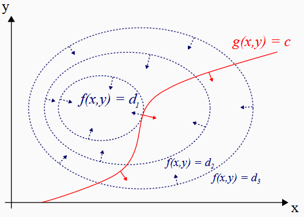

$\newcommand{\m}[1]{\mathbf{#1}} \newcommand{\ints}{\text{int }}$

!!! Definition "[Definice 7.4 (Lagrangeova funkce)](#def-7.4)"

    ### Definice 7.4 (Lagrangeova funkce) {#def-7.4}

    Mějme úlohu nalézt lokální extrémy funkce $f : D \to \mathbb{R}$, kde $D \subseteq \mathbb{R}^n$, vzhledem k množině

    $$
    \mathcal{M} = \{\m{x} \in D : g_i(\m{x}) = 0, h_j(\m{x}) \le 0, i = 1, 2, \dots, m, j = 1, \dots, p\},
    $$

    kde $g_i, h_j : \mathbb{R}^n \to \mathbb{R}$.

    Funkci $L : \mathcal{M} \times \mathbb{R}^m \times \mathbb{R}^p \to \mathbb{R}$ definovanou

    $$
    L(\m{x}; \m{\lambda}; \m{\mu}) = f(\m{x}) + \sum_{j=1}^{m} \lambda_j g_j(\m{x}) + \sum_{k=1}^{p} \mu_k h_k(\m{x})
    $$

    nazýváme **Lagrangeovou funkcí** pro danou úlohu. Koeficienty

    $$
    \m{\lambda} = (\lambda_1, \dots, \lambda_m) \quad \text{a} \quad \m{\mu} = (\mu_1, \dots, \mu_p)
    $$
    
    nazýváme **Lagrangeovy multiplikátory** (_Lagrange multipliers_).

K čemu nám Lagrangeova funkce je? Uvažujme jednu rovnostní vazbu (tedy $m = 1$). Pokud v bodě $\m{x}^*$ platí, 
že gradient vazby i naší funkce mají stejný směr, tedy $\nabla f (\m{x}^*) = −λ_1^* \nabla g_1(\m{x}^*)$, 
pak ”vazba v daném bodě neprotíná vrstevnici“

{ align=center }
